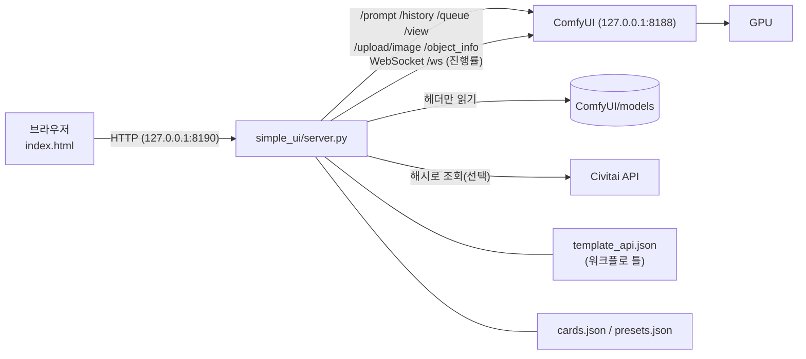
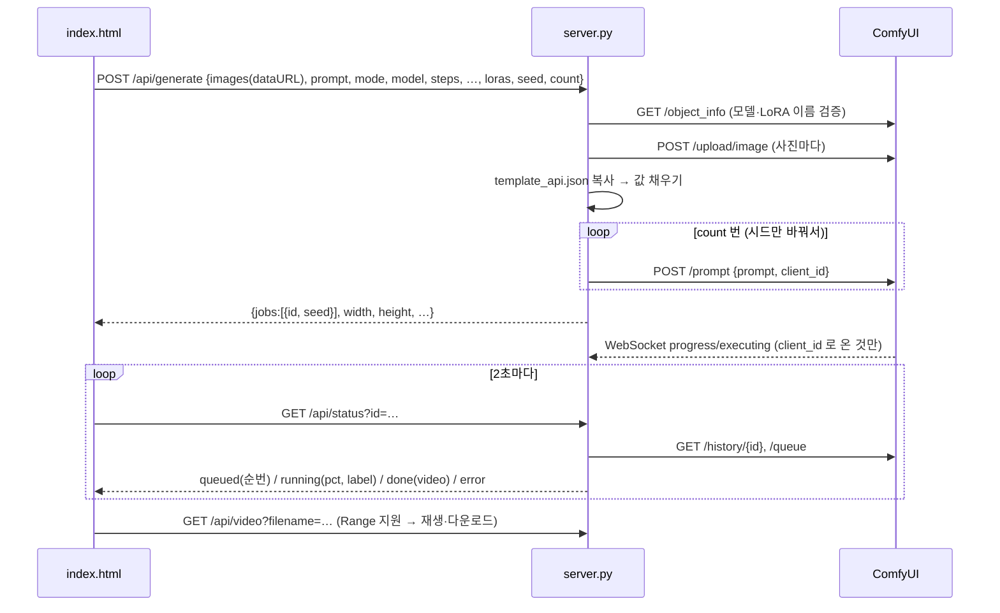

# 설계 문서

간단 화면이 어떻게 ComfyUI 워크플로를 움직이는지, 무엇을 고정하고 무엇을 바꾸는지 정리한 문서입니다.
코드를 고치거나 기능을 더하기 전에 이 문서를 먼저 읽으세요.

## 1. 구성요소



| 구성요소 | 역할 | 비고 |
|---|---|---|
| ComfyUI | 실제 생성 엔진 | 고정 커밋([versions.json](../versions.json)) |
| ComfyUI-DaSiWa-Nodes | MiniMaxH3Director(프롬프트·사진·모드 처리), SeedControl, LoRA 묶음, 이어붙이기, 영상 저장 | GPL-3.0 |
| ComfyUI-KJNodes | 생성 중 미리보기(ModelPreviewOverrideKJ), torch 설정 | |
| template_api.json | DaSiWa 워크플로 `C-MMH3-33` 을 한 번 실행해 뽑은 **API 프롬프트** | 노드 구조의 원본. 서버는 **값만** 바꿈 |
| server.py | 화면 API, 템플릿 값 채우기, 진행률 추적, 모델 카드·조합 저장 | 표준 라이브러리 + Pillow + aiohttp(ComfyUI venv 에 이미 있음) |
| index.html | 화면 전체(HTML+CSS+JS 한 파일) | 외부 라이브러리·CDN 없음 |

### 왜 "틀에 값만 채우기"인가
- DaSiWa 워크플로는 노드 수십 개가 얽혀 있어 직접 다시 짜면 원작자 구성과 어긋나기 쉽다.
- 그래서 원본 워크플로를 그대로 실행한 API 프롬프트를 틀로 두고, 사용자가 바꿀 수 있는 **값**(사진·프롬프트·모델 파일명·스텝·LoRA 칸 등)만 덮어쓴다.
- 노드를 추가·삭제하지 않으므로, 원본 워크플로와의 차이는 "어떤 값을 넣었나"뿐이다.

## 2. 템플릿 노드 지도

`server.py` 상단 상수와 1:1 대응. **노드 번호가 바뀌면(템플릿을 다시 뽑으면) 여기와 상수를 같이 고친다.**

| 상수 | 노드 ID | class_type | 서버가 바꾸는 입력 |
|---|---|---|---|
| `DIRECTOR` | `2730` | MiniMaxH3Director | `mode`, `prompt`, `width`, `height`, `duration`, `timeline_data`(items·프롬프트·해상도), `builder_state` |
| `SEED` | `2739` | DaSiWa_SeedControl | `seed_value` (0이 아니면 그 값을 그대로 씀) |
| `SAVE` | `2568` | DaSiWa_EnhancedVideoCombine | (읽기만) 결과 파일은 history 의 `outputs[2568].gifs` |
| `LOADERS[0]` | `1512:2586` | UNETLoader | `unet_name` — Director 의 `fl2va_model` 입력 |
| `LOADERS[1]` | `1512:2588` | UNETLoader | `unet_name` — Director 의 `ref2va_model` 입력 |
| `SCHED` | `1512:2590` | BasicScheduler | `steps`, `scheduler` |
| `SAMPLER` | `1512:2598` | KSamplerSelect | `sampler_name` |
| `SHIFT` | `1512:2692` | MiniMaxH3SigmaShift | `shift_video`, `shift_audio` |
| `LORA` | `2678` | DaSiWa_LTX2LoraLoader | `stack_data` — 10칸 `[{on, lora, str, vs, as}]`, 빈칸은 `lora:"None"` |

그대로 두는 노드: CLIPLoader(`qwen3vl…nvfp4_awq`), VAELoader 2개(영상 int8·소리 fp32), ModelAttentionBackend(`comfy kitchen attention`), ModelPatchTorchSettings(fp16 누적), ModelPreviewOverrideKJ(`taeh3`), BasicGuider, SamplerCustomAdvanced, 이어붙이기 노드들.

- Director 의 모델 입력은 **lazy** 라서 모드에 맞는 쪽 하나만 실제로 불러온다(`REF2VA` → `ref2va_model`, 그 외 → `fl2va_model`). 서버는 두 로더에 같은 파일을 넣는다.
- LoRA 묶음은 Director 출력(선택된 모델) 뒤에 붙으므로 모드와 상관없이 적용된다.

## 3. 요청 한 번의 흐름



### 진행률 계산
WebSocket 이벤트를 prompt_id 별로 받아 노드 종류에 따라 구간을 나눈다(단조 증가만 허용).

| 구간 | 노드 | % |
|---|---|---|
| 모델 불러오기 | 이름에 `Loader` | 2–10 |
| 사진·프롬프트 처리 | 그 외 | 10–15 |
| 영상 생성 | SamplerCustomAdvanced (스텝 진행) | 15–82 |
| 디코딩 | 이름에 `Decode` | 82–95 |
| 파일 저장 | VideoCombine | 95–99 |

### 반복(count)
- 같은 템플릿으로 `seed_value` 만 바꿔 `count`(1–20)개를 연속으로 대기열에 넣는다.
- 시드를 적으면 `seed, seed+1, …`(재현 가능), 비우면 매번 랜덤.
- 화면은 작업별로 상태를 따로 조회하고, 끝난 영상만 목록에 그린다(재생 중 영상은 다시 그리지 않음).
- 중지: 대기열에서 먼저 빼고(`/queue delete`), 돌고 있는 것은 `prompt_id` 를 지정해 `/interrupt` — **다른 사람이 ComfyUI 화면에서 돌리는 작업은 건드리지 않는다.**

## 4. 프롬프트 형식

화면의 칸을 모아 Director 가 기대하는 형식으로 만든다(최종 프롬프트 칸에서 직접 고칠 수도 있음).

**REF2VA (참조 사진)**
```
subject_definitions: <Picture 1> shows the main subject. Copy the face, hairstyle, outfit and background from <Picture 1>.
summary: …
retention_analysis: …(유지할 것)
detailed_description: [트리거 단어.] 분위기·카메라 [Shot 1] … [Shot 2] At 00:02.000, …
overall_soundscape: …
non_diegetic_music: N/A
```
- 사진이 여러 장이면 subject 문장이 "모든 사진은 같은 대상, 얼굴·정체성만 참고, **옷·머리·배경은 Picture 1 에서만**"으로 바뀐다(사진마다 옷이 달라 영상 끝에 옷이 바뀌던 문제 대응).
- 성별·생김새는 적지 않는다. 사진에서 가져오게 하는 것이 원칙.

**FL2VA / I2VA (첫·끝 장면)** — 사진 2장이면 FL2VA, 1장이면 I2VA 로 보낸다.
```
How the reference pictures align with the target video — Picture 1 (from Shot 1) aligns with the 0.00-second mark …; Picture 2 (from Shot 2) aligns with the end mark …
integrated_multimodal_description: [트리거 단어.] 요약 분위기 장면들 유지할 것
overall_soundscape: …
non_diegetic_music: …
```
(머리말 문장은 DaSiWa Director JS 의 기본 문장을 그대로 사용.) timeline items 의 `slot` 0 = 첫 장면, 1 = 끝 장면.

## 5. 모델 카드 (파일별 기본값)

서버는 ComfyUI 가 보는 목록(`/object_info/UNETLoader`, `/object_info/LoraLoaderModelOnly`)을 그대로 쓰고, 파일마다 카드를 만든다. 카드는 `cards.json` 에 저장된다(처음엔 `cards.seed.json` 에서 시작).

```
card = { auto: 파일 헤더·이름 판정, civitai: 해시 조회 결과, user: 사용자가 저장한 값 }
effective = 기본 규칙 ← civitai.suggest ← user   (오른쪽이 이김)
```

**auto 판정 규칙** (`analyze()`)
| 항목 | 규칙 |
|---|---|
| H3 본체 모델인가 | 헤더에 `audio_patch_proj.weight` 가 있거나 `modelspec.architecture == minimax_h3` |
| H3 용 LoRA 인가 | LoRA 키의 모듈 이름(블록 번호 무시)이 H3 본체 모듈 이름과 60% 이상 겹치거나, 메타데이터에 `minimax-h3/minimax_h3` |
| 방식 | 이름에 `fl2v` → 첫·끝 장면, `ref2v` → 참조 사진, `dasiwa` → 둘 다(REF2VA+FL2VA 혼합 모델), 단서 없음 → 둘 다 |
| 터보 | 이름에 `turbo / distill / lightspeed / lightning` |
| 스텝 힌트 | 이름의 `8step`, `4turbo` 같은 숫자 |
| 형식 | 이름의 `int8 / w6a8 / w4a8 / fp8 / nvfp4 / bf16 …`, 없으면 텐서 dtype |
| 사용 불가 | GGUF(불러오는 노드가 다름), H3 아님 |

**기본값 규칙** (`effective()`)
- 모델: 터보면 스텝 `힌트 또는 4`·`euler`, 아니면 `20`·`res_multistep`. 스케줄러 `simple`, shift 영상 10·소리 3.
- Civitai 설명문에서 `N-Step: Quality` 같은 문구를 찾으면 스텝을 그 값으로.
- LoRA: 강도 1.0, 설명문에 `strength/weight 0.65` 같은 값이 있으면 그 값. 터보 LoRA 는 스텝 힌트를 가짐.
- 화면: 터보가 아닌 모델에 터보 LoRA 를 넣으면 스텝을 그 LoRA 의 힌트로 바꾼다.

**Civitai 조회**: 파일 전체 SHA256 → `GET /api/v1/model-versions/by-hash/{sha}` → 이름·기반 모델·트리거 단어·설명. 404 면 "Civitai 에 없음"으로 기록. LoRA(<4GB)는 처음 보일 때 자동, 본체 모델은 버튼(해시에 수십 초). 파일 크기·수정시각이 바뀌면 다시 판정한다.

**화면 표시 이름**(index.html `friendlyModel/friendlyLora`)도 이름 패턴 규칙이다: `dasiwa` → "DaSiWa v번호(+GXS)(+터보)", `minimax_h3_ref2va/fl2va` → "MiniMax H3 기본 · ○○용", 터보 LoRA → "터보 가속 N스텝", 그 외 → Civitai 이름 또는 파일명. 같은 파일이 폴더 두 곳에 있으면(이름·크기 같음) 하나만 보여 준다.

## 6. 서버 API

| 메서드·경로 | 설명 |
|---|---|
| `GET /` | index.html (no-store) |
| `GET /api/catalog` | `{models, loras, samplers, schedulers, presets, default}` — 카드 포함. 처음 보는 작은 LoRA 는 Civitai 조회를 자동으로 대기열에 넣음 |
| `POST /api/card/fetch {kind, name}` | Civitai 조회 시작 |
| `POST /api/card/save {kind, name, values}` | 사용자 기본값 저장(모델: steps·sampler·scheduler·shift_video·shift_audio / LoRA: strength·steps) |
| `GET /api/fetch-state` | 조회 진행 상태 |
| `POST /api/preset/save {name, data}` · `/api/preset/delete {name}` | 조합 저장·삭제 |
| `POST /api/generate` | 아래 본문. 응답 `{jobs:[{id,seed}], id, seed, width, height, model, steps, loras, mode}` |
| `GET /api/status?id=` | `queued(position) / running(pct,label) / done(video) / error(error) / unknown` |
| `GET /api/video?filename&subfolder&type[&download=1]` | ComfyUI `/view` 중계(Range 지원) |
| `POST /api/cancel {ids:[…]}` | 이 화면에서 만든 작업만 중지 |
| `POST /api/open-folder` · `/api/open-models {kind}` | 탐색기로 결과·모델 폴더 열기 |

`/api/generate` 본문:
```json
{
  "images": ["data:image/jpeg;base64,…"], "prompt": "…",
  "mode": "REF2VA | FL2VA | I2VA",
  "model": "MiniMaxH3\\dasiwa_…turbo_int8….safetensors",
  "steps": 8, "sampler": "euler", "scheduler": "simple", "shift_video": 10, "shift_audio": 3,
  "loras": [{"name": "xxx.safetensors", "strength": 0.8}],
  "aspect": "auto | 16:9 | …", "resolution": "draft | auto | 720p | 1080p", "duration": 5,
  "seed": "", "count": 1
}
```
검증: 사진 수(REF2VA 1–9, FL2VA 2, I2VA 1), 길이 1–15초(H3 최대 15초·24fps), 스텝 1–60, LoRA ≤10, 반복 1–20, 모델·LoRA 가 ComfyUI 목록에 있고 H3 용일 것.

### 해상도
- 기본(auto): 짧은 변 768, 첫 사진 비율, 32 배수.
- draft(초안) = 0.4MP(공식 H3 문서의 빠른 시험용 크기, 어떤 화면비든 짧은 변이 H3 최소 384 이상), 720p ≈ 0.879MP, 1080p ≈ 1.978MP(같은 비율로 맞춤). 720p·1080p 는 Director JS 계산과 같음. auto 는 짧은 변 768.

## 7. 저장되는 데이터

| 파일 | 내용 | 배포 |
|---|---|---|
| `simple_ui/cards.json` | 파일별 auto·civitai·user | PC 마다 생성(.gitignore). 처음엔 `cards.seed.json` 복사 |
| `simple_ui/presets.json` | 조합 | PC 마다(.gitignore). 처음엔 `presets.seed.json` 복사 |
| 브라우저 localStorage | 입력 칸 내용, 마지막 모델 선택(사진 제외) | 브라우저별 |
| `ComfyUI/input/simpleui_*.jpg` | 업로드한 사진 | PC 에만 남음 |
| `ComfyUI/output/video/날짜/*.mp4` | 결과 | |

## 8. 지원 범위와 한계

- 틀 하나(DaSiWa C-MMH3-33)만 쓴다. Wan·LTX 등 다른 계열 모델은 노드 구조가 달라 이 틀로 못 돌린다(틀을 하나 더 만들어야 함).
- GGUF 는 불러오는 노드가 달라 막아 두었다.
- 제작자가 별도 노드(예: Conditioning Bridge)를 권하는 LoRA 는 그 노드 없이 LoRA 만 적용된다.
- int8 같은 압축 모델에 LoRA 를 얹으면 빠른 int8 계산 대신 일반 계산 경로를 탈 수 있어 느려질 수 있다(코드상 추정, 실측 안 함).
- 서버·ComfyUI 모두 127.0.0.1 에만 열린다. 외부 공개용이 아니다(인증 없음).
