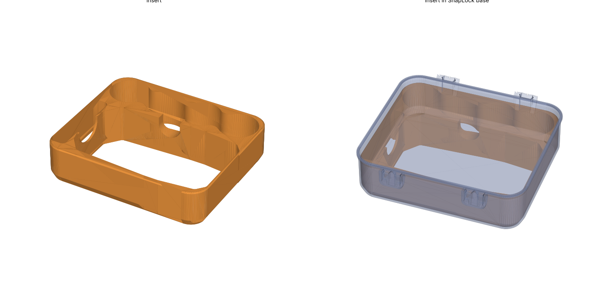
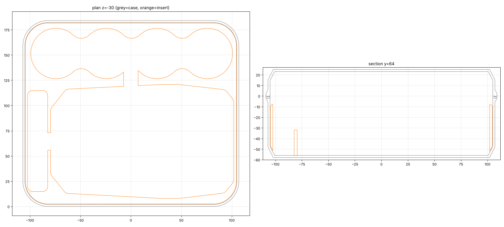

# Niimbot M2 케이스 (SnapLock V3 + 전용 인서트)

Niimbot M2 라벨프린터(178 × 108 × 74 mm)와 라벨 롤 4개를 담는 케이스.

## 파일

| 파일 | 내용 |
|---|---|
| [`models/SnapLock_V3_case_210x180_h58.stl`](models/SnapLock_V3_case_210x180_h58.stl) | SnapLock V3 케이스, 조립 상태. 슬라이서에서 "Split to objects"로 몸통·뚜껑·래치 2개·가스켓(TPU, 선택)으로 나눠 출력 |
| [`models/Niimbot_M2_insert_SnapLockV3.stl`](models/Niimbot_M2_insert_SnapLockV3.stl) | 전용 인서트 (209.2 × 179.2 × 48 mm), 출력 방향으로 배치됨 |
| [`models/Niimbot_M2_insert_TEST_slice_4mm.stl`](models/Niimbot_M2_insert_TEST_slice_4mm.stl) | 인서트 4 mm 시험 조각 (약 27 g). 본품 전에 맞춤 확인용 |
| [`model/build_insert.py`](model/build_insert.py) | 인서트 생성 스크립트 (trimesh + shapely + manifold3d) |

## SnapLock V3 생성 값 (MakerWorld Parametric Model Maker)

- Inside width 210 / Inside length 180 / height 58 / Corner radius 25
- 결과: 바깥 218 × 204.2 × 83 mm, 안쪽 210 × 180 × 79 mm (몸통 56 + 뚜껑 23)

## 인서트

- 원본 Niimbot M2 케이스 인서트(3Doctor)의 칸 배치를 90° 회전해 사용
  - 앞쪽(래치 쪽): 프린터 칸 / 뒤쪽(힌지 쪽): 롤 4개 / 왼쪽: 케이블 칸
- 케이스 벽과 한 면당 0.4 mm 여유, 케이스 바닥 모서리 경사(4.24 × 8.47 mm)를 피하도록 아래 모서리 경사 처리
- 프린터 칸 오른쪽 끝을 x = 100.6으로 줄여 프린터가 바닥 경사에 올라타지 않게 함 (칸 길이 180.1 mm)
- 손가락 홈 2개 (깊이 24 mm): 프린터·롤 사이 벽 가운데, 프린터·케이블 칸 사이 벽
- 뚜껑 닫았을 때 프린터 위 여유 5 mm

## 출력

- 인서트: 바닥 아래로, 서포트 없음, 채움 15 %, 벽 2~3겹, PETG 약 161 g
- 순서: 케이스 → 시험 조각으로 케이스 맞춤과 프린터·롤 칸 확인 → 인서트 본품

## 검증

- 새 SnapLock 파일과 직접 맞대 본 측면 최소 간격 0.37 mm, 뚜껑 닫힘 시 프린터 위 5 mm·옆 2.6 mm 여유
- 메쉬 닫힌 입체, 서포트 필요 없음
- 확인 못 한 것: 실제 프린터 실측(판매처 표기 178 × 108 × 74 mm 기준), 라벨 롤 높이, 출력 공차

## 출처

- SnapLock V3: Hugo, MakerWorld (https://makerworld.com/models/2168356)
- Niimbot M2 robust case: 3Doctor, MakerWorld
- 개인 사용 목적. 원본 모델의 라이선스를 따름.
