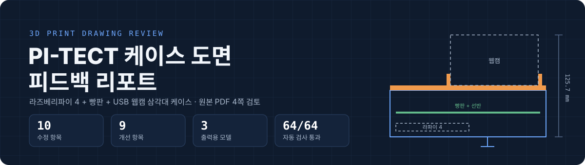
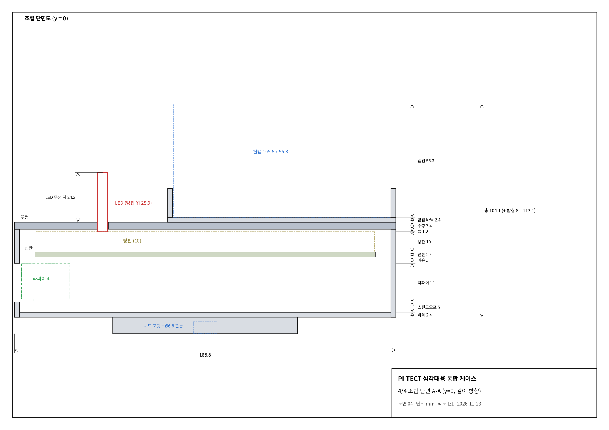
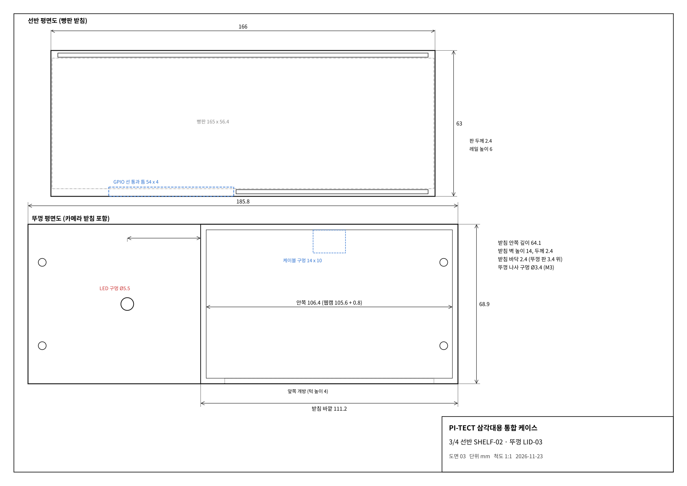
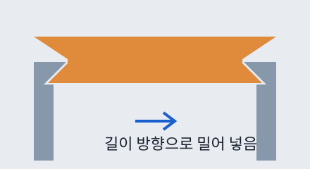

  

  <a href="#검토-원본">검토 원본</a> ·
  <a href="#리포트-1-꼭-고쳐야-하는-10가지">리포트 1</a> ·
  <a href="#리포트-2-고치면-나아지는-9가지">리포트 2</a> ·
  <a href="#리포트-3-설계-방향">리포트 3</a> ·
  <a href="#모델-바로가기">모델</a> ·
  <a href="#받은-뒤-할-일">할 일</a> ·
  <a href="#문서-목록">문서 목록</a>

  
   실측값을 넣어 모델을 다시 만들고 3D로 확인하기 (설치 없이 브라우저에서 실행)

> [!IMPORTANT]
> **결론: 원본 도면은 그대로 출력할 수 없습니다.** 조립이나 기능이 안 되는 곳이 10군데 있습니다. 이를 모두 고친 출력용 모델을 세 가지 결합 방식으로 만들어 두었고, 첫 출력은 **모델 A**를 권합니다.

<table>
<tr>
<td width="50%" align="center"> <b>원본 도면</b> · 높이 112.1 mm · 나사 8개</td>
<td width="50%" align="center"> <b>수정 모델 A</b> · 높이 125.7 mm · 나사 4개</td>
</tr>
</table>

  

## 검토 원본

**[마프_3D프린팅_도면.pdf](original/마프_3D프린팅_도면.pdf)** · 라즈베리파이 4, 풀사이즈 빵판, USB 웹캠을 한 몸체에 담아 삼각대에 올리는 케이스의 4쪽짜리 1:1 도면

<table>
<tr>
<td align="center" width="25%"> <b>1쪽</b> 개요 · 부품표</td>
<td align="center" width="25%"> <b>2쪽</b> 케이스</td>
<td align="center" width="25%"> <b>3쪽</b> 선반 · 뚜껑</td>
<td align="center" width="25%"> <b>4쪽</b> 조립 단면</td>
</tr>
</table>

## 리포트 1. 꼭 고쳐야 하는 10가지

<table>
<tr>
<td width="33%" valign="top"><h4>조립이 안 됩니다</h4>왼쪽 뚜껑 기둥 2개가 라파이의 USB/랜 포트 자리와 겹칩니다.  1번 항목</td>
<td width="33%" valign="top"><h4>서포트 없이 출력이 안 됩니다</h4>받침을 베드에 놓으면 케이스 바닥이 양쪽으로 약 48 mm씩 허공에 뜹니다.  8번 항목</td>
<td width="33%" valign="top"><h4>구멍이 맞지 않습니다</h4>라파이 고정 구멍이 규격보다 7~10 mm 어긋나 있습니다.  2번 항목</td>
</tr>
</table>

| # | 문제 | 고친 방법 | 검토 | 모델 |
|:---:|---|---|:---:|---|
| **1** | 왼쪽 뚜껑 기둥이 라파이 USB/랜 포트 자리와 겹침 | 기둥을 없애고 후크 · 레일 · 스냅으로 대체 |  | 케이스 [A](models/A_case.stl) · [B](models/B_case.stl) · [C](models/C_case.stl) |
| **2** | 라파이 고정 구멍이 규격보다 7~10 mm 어긋남 | 규격대로 다시 배치 |  | 케이스 [A](models/A_case.stl) · [B](models/B_case.stl) · [C](models/C_case.stl) |
| **3** | 빵판 위 틈이 1.2 mm라 점퍼선을 꽂을 수 없음 | 틈을 20 mm로 늘림 |  | 케이스 [A](models/A_case.stl) · [B](models/B_case.stl) · [C](models/C_case.stl) |
| **4** | 웹캠 케이블 구멍이 웹캠 밑에 깔림 | 구멍을 없애고 케이블을 바깥으로 |  | 뚜껑 [A](models/A_lid.stl) · [B](models/B_lid.stl) · [C](models/C_lid.stl) |
| **5** | 삼각대 나사를 조여도 케이스가 조여지지 않음 | 너트를 케이스 안쪽에서 넣는 구조로 |  | 케이스 [A](models/A_case.stl) · [B](models/B_case.stl) · [C](models/C_case.stl) |
| **6** | LED 구멍(Ø5.5)에 LED 테두리가 걸림 | 구멍을 Ø6.4로 |  | 뚜껑 [A](models/A_lid.stl) · [B](models/B_lid.stl) · [C](models/C_lid.stl) |
| **7** | 오른쪽 뚜껑 나사가 웹캠 밑에 깔림 | 웹캠 받침을 옮겨 나사 자리 확보 |  | 뚜껑 [A](models/A_lid.stl) · [B](models/B_lid.stl) · [C](models/C_lid.stl) |
| **8** | 받침 때문에 케이스 바닥이 허공에 떠 서포트 없이 출력 불가 | 받침을 없애고 바닥을 평평하게 |  | 케이스 [A](models/A_case.stl) · [B](models/B_case.stl) · [C](models/C_case.stl) |
| **9** | 선반 턱이 직각 오버행이고 라파이가 들어갈 틈이 좁음 | 턱 아래를 45°로, 라파이 구간은 좁게 |  | 케이스 [A](models/A_case.stl) · [B](models/B_case.stl) · [C](models/C_case.stl) · [선반](models/shelf.stl) |
| **10** | 뒤벽 창의 아랫변이 높아 전원 · HDMI 플러그가 걸림 | 창을 4 mm 내림 |  | 케이스 [A](models/A_case.stl) · [B](models/B_case.stl) · [C](models/C_case.stl) |

**[리포트 1 전체 보기 →](reports/1-fix.md)** 원본 수치, 교차 검토 메모, 변수까지

## 리포트 2. 고치면 나아지는 9가지

-  **발열** · 바닥과 앞벽에 통풍 슬롯 추가
-  **웹캠 고정** · 벨크로 스트랩 걸이 2개 추가
-  **포트 창 브리지** · 떼어내는 리브로 나눠 서포트 없이 출력
-  **라파이 나사 구멍** · Ø2.5 → Ø2.2, 위치 핀 추가
-  **뚜껑 기둥** · 벽에 붙은 굵은 보스로 변경
-  **남는 케이블** · 뒤벽에 케이블 타이 고리 추가
-  **웹캠 받침** · 이중 바닥 삭제
-  **SD 카드** · 선반을 들어내야 교체 가능 (구조상 그대로)
-  **도면 표기** · 모델 하나를 기준으로 삼아 도면 간 불일치 제거

**[리포트 2 전체 보기 →](reports/2-improve.md)**

## 리포트 3. 설계 방향

- **2층 구조는 유지** · 풀사이즈 빵판을 쓰는 한 라파이 위에 선반을 얹는 구조가 가장 효율적입니다
- **높이는 112.1 → 125.7 mm** · 외부 받침 8 mm를 없애고 점퍼선 공간 20 mm를 확보했습니다
- **나사는 8개 → 4개 또는 0개** · 결합 방식 세 가지를 추천 순서대로 모델로 만들었습니다

<table>
<tr>
<td width="33%" align="center" valign="top">
<h4>추천 1 · 후크 + 나사</h4>
 
 
<b>모델 A</b> · 첫 출력, 이동 사용 
<a href="models/A_case.stl">케이스</a> · <a href="models/A_lid.stl">뚜껑</a>
</td>
<td width="33%" align="center" valign="top">
<h4>추천 2 · 더브테일 슬라이드</h4>
 
 
<b>모델 B</b> · 자주 열어 배선을 바꿀 때 
<a href="models/B_case.stl">케이스</a> · <a href="models/B_lid.stl">뚜껑</a> · <a href="models/B_lock_pin.stl">잠금 핀</a>
</td>
<td width="33%" align="center" valign="top">
<h4>추천 3 · 캔틸레버 스냅락</h4>
 
 
<b>모델 C</b> · 실내 고정 사용 
<a href="models/C_case.stl">케이스</a> · <a href="models/C_lid.stl">뚜껑</a>
</td>
</tr>
</table>

**[리포트 3 전체 보기 →](reports/3-direction.md)** 구조 변경 표, 층별 높이, 결합 방식별 원리와 주의점

## 모델 바로가기

| 버전 | 케이스 | 뚜껑 | 추가 부품 | 시험 조각 |
|---|---|---|---|---|
| **A · 나사형** | [A_case.stl](models/A_case.stl) | [A_lid.stl](models/A_lid.stl) | | [바닥](models/test_A_floor.stl) |
| **B · 슬라이드형** | [B_case.stl](models/B_case.stl) | [B_lid.stl](models/B_lid.stl) | [잠금 핀](models/B_lock_pin.stl) | [레일 케이스](models/test_B_rail_case.stl) · [레일 뚜껑](models/test_B_rail_lid.stl) |
| **C · 스냅락형** | [C_case.stl](models/C_case.stl) | [C_lid.stl](models/C_lid.stl) | | [스냅 케이스](models/test_C_snap_case.stl) · [스냅 뚜껑](models/test_C_snap_lid.stl) |
| **공통** | | | [선반](models/shelf.stl) | [창](models/test_window.stl) |

> [!TIP]
> GitHub에서 STL 파일을 누르면 3D로 돌려 볼 수 있습니다. 크기와 출력 방향은 **[모델과 STL](reports/models.md)** 에 있습니다.

## 받은 뒤 할 일

1. **실측 4가지** · USB 포트에서 구멍까지 거리, 삼각대 나사 길이, 플러그 몸통 크기, LED 테두리 지름
2. **값이 다르면 다시 생성** · [Colab 노트북](https://colab.research.google.com/github/imjihwan/dev-work/blob/main/pitect-case/model/pitect_colab.ipynb)에 실측값을 넣고 실행하면 STL이 새로 나옵니다. 다른 방법은 [파라메트릭 적용 기능](reports/parametric.md)에 있습니다
3. **시험 조각부터 출력** · 창, 바닥 조각으로 맞춤을 확인합니다
4. **본체 출력** · 모델 A, PETG, 레이어 0.2, 서포트 없음

**[출력 가이드 →](reports/print-guide.md)**

## 문서 목록

| 문서 | 내용 |
|---|---|
| **[리포트 1. 수정 목록](reports/1-fix.md)** | 안 고치면 안 되는 10가지. 원본 수치, 반영 내용, 교차 검토, 연결된 모델 |
| **[리포트 2. 개선 목록](reports/2-improve.md)** | 고치면 나아지는 9가지와 반영 여부 |
| **[리포트 3. 설계 방향](reports/3-direction.md)** | 구조 변경, 층별 높이, 추천 결합 방식 3가지 |
| **[모델과 STL](reports/models.md)** | 세 버전 비교, STL 14개의 크기와 출력 방향 |
| **[파라메트릭 적용 기능](reports/parametric.md)** | 실측값을 넣어 STL을 다시 만드는 방법과 변수 설명 |
| **[모델 최종 검수](reports/final-check.md)** | Claude와 Codex의 STL 검수 결과, 검증 범위와 한계 |
| **[출력 가이드](reports/print-guide.md)** | 출력 전에 잴 값, 시험 조각, 출력과 조립 순서 |
| **[Colab 노트북](https://colab.research.google.com/github/imjihwan/dev-work/blob/main/pitect-case/model/pitect_colab.ipynb)** | 설치 없이 브라우저에서 파이썬 모델을 실행. 실측값 입력, 3D 확인, STL 내려받기 |
| **[대화형 리포트](docs/index.html)** | 내려받아 브라우저로 열면 3D 미리보기를 돌려 볼 수 있는 HTML 판 |
| **[검토 원본 PDF](original/마프_3D프린팅_도면.pdf)** | 검토한 4쪽 도면 |

검토와 모델링 Claude · 교차 검토 Codex · 2026-11-23

