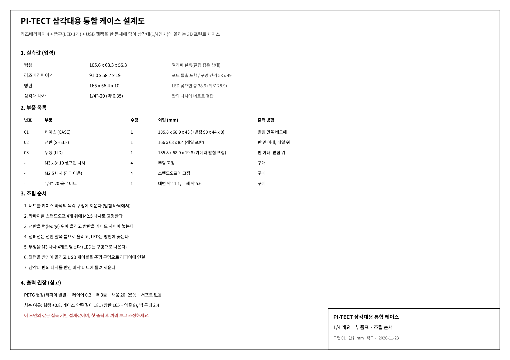
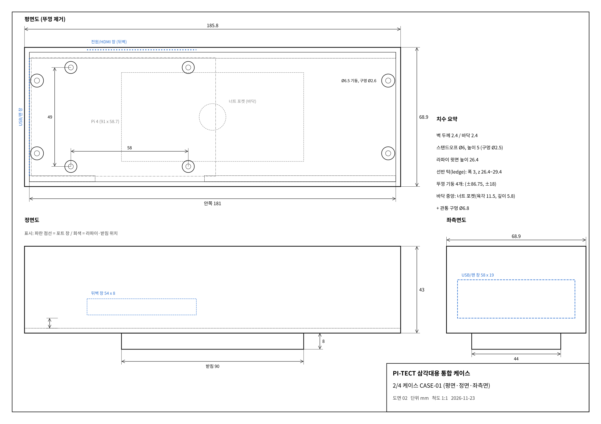
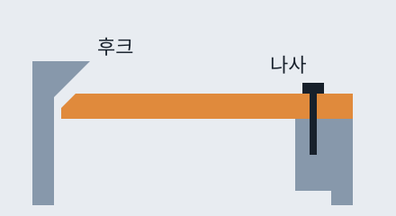
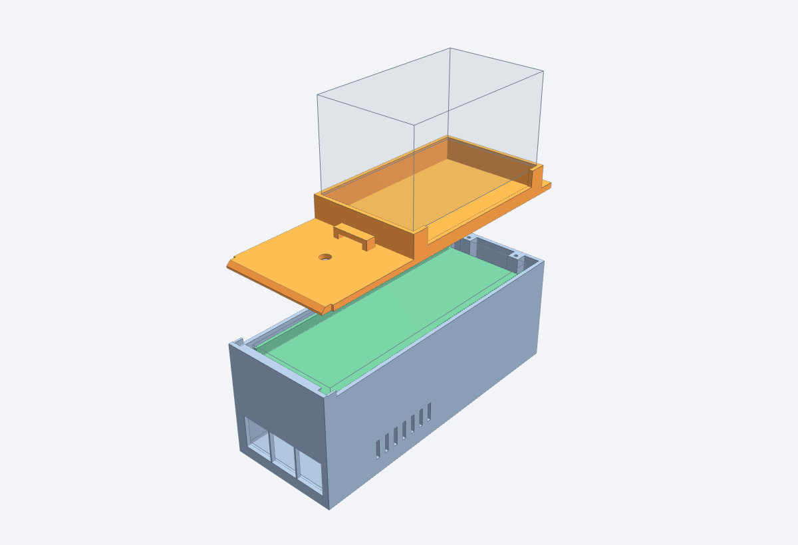
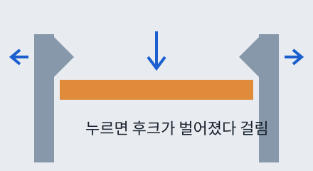
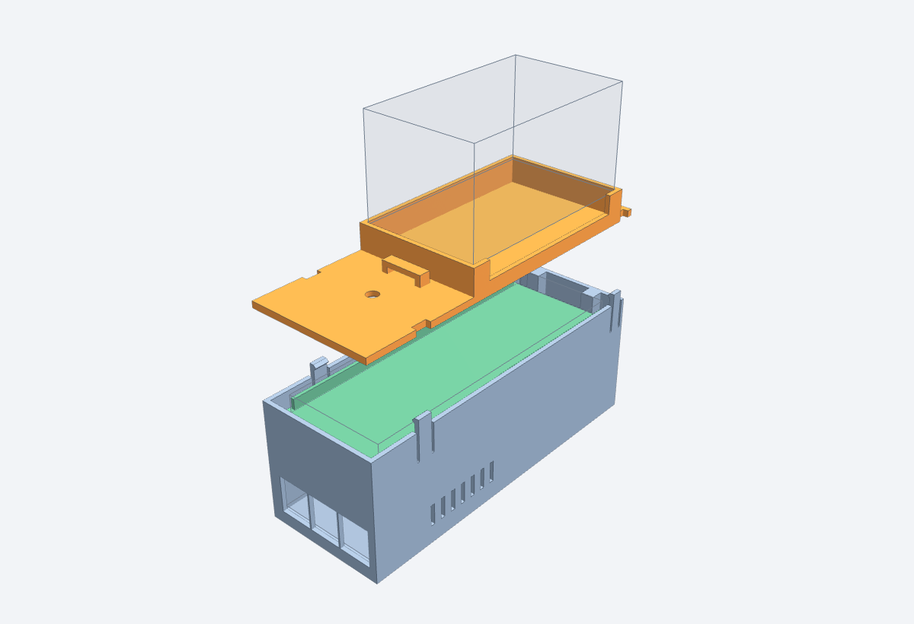

# PI-TECT 케이스 도면 피드백 리포트

3D 프린트용 케이스 도면 PDF 한 건을 검토한 피드백 리포트입니다. 원본 도면은 그대로 출력하면 조립이나 기능이 안 되는 곳이 10군데 있었고, 리포트의 각 항목을 반영한 출력용 모델까지 연결해 두었습니다.

```
검토 원본 PDF  →  리포트 1 · 2 · 3  →  파라메트릭 모델 (model/)  →  출력용 STL (models/)
```

차례: [검토 원본](#검토-원본) · [리포트 구성](#리포트-구성) · [리포트 1. 수정 목록](#리포트-1-수정-목록) · [리포트 2. 개선 목록](#리포트-2-개선-목록) · [리포트 3. 설계 방향](#리포트-3-설계-방향) · [연결된 모델](#연결된-모델) · [파라메트릭 적용 기능](#파라메트릭-적용-기능) · [모델 최종 검수](#모델-최종-검수) · [출력 가이드](#출력-가이드) · [검증 범위와 한계](#검증-범위와-한계) · [폴더](#폴더)

## 검토 원본

검토한 파일은 [`original/마프_3D프린팅_도면.pdf`](original/마프_3D프린팅_도면.pdf)입니다. 라즈베리파이 4, 풀사이즈 빵판(LED 1개), USB 웹캠을 한 몸체에 담아 삼각대(1/4인치)에 올리는 케이스를 그린 4쪽짜리 1:1 도면입니다.

| 1쪽 개요 · 부품표 · 조립 순서 | 2쪽 케이스 | 3쪽 선반 · 뚜껑 | 4쪽 조립 단면 |
|---|---|---|---|
| [](original/page-1.png) | [](original/page-2.png) | [](original/page-3.png) | [](original/page-4.png) |

| 원본 도면의 내용 | 값 |
|---|---|
| 실측값 | 웹캠 105.6 x 63.3 x 55.3, 라파이 4 91.0 x 58.7 x 19, 빵판 165 x 56.4 x 10, 삼각대 나사 1/4"-20 |
| 부품 | 케이스 185.8 x 68.9 x 43 (+받침 90 x 44 x 8), 선반 166 x 63 x 8.4, 뚜껑 185.8 x 68.9 x 19.8 |
| 구매 부품 | M3 셀프탭 4, M2.5 나사 4, 1/4"-20 너트 1 |
| 전체 높이 | 112.1 mm |
| 출력 조건 | PETG, 레이어 0.2, 벽 3줄, 서포트 없음 |

검토 방법: PDF의 벡터 좌표를 직접 추출해 평면도와 단면도를 수치로 대조했고, 라즈베리파이 4의 구멍과 포트 위치는 공식 기구 도면 값을 썼습니다. Claude가 검토하고 Codex로 교차 검토했습니다.

## 리포트 구성

| 리포트 | 답하는 질문 | 결과 | 연결된 모델 |
|---|---|---|---|
| [1. 수정 목록](#리포트-1-수정-목록) | 안 고치면 조립, 기능, 출력이 안 되는 곳은? | 10개. 교차 검토에서 8개 일치, 2개 판단 보류, 반박 0개 | 10개 모두 세 버전의 케이스와 뚜껑에 반영 |
| [2. 개선 목록](#리포트-2-개선-목록) | 동작은 하지만 고치면 나아지는 곳은? | 9개 | 7개 반영, 1개 미반영, 1개는 모델로 대체 |
| [3. 설계 방향](#리포트-3-설계-방향) | 구조와 결합 방식을 어떻게 바꿀까? | 2층 구조 유지, 받침 삭제, 추천 결합 방식 3가지 | 결합 방식별 A · B · C 세 버전 |

각 리포트의 표 마지막 열에 그 항목이 어느 STL과 어느 변수로 구현됐는지 적었습니다. 변수는 [`model/pitect.js`](model/pitect.js)의 이름이며 [파라메트릭 적용 기능](#파라메트릭-적용-기능)에서 설명합니다.

## 리포트 1. 수정 목록

안 고치면 조립, 기능, 출력 중 하나가 안 되는 10가지입니다.

| # | 위치 | 원본 도면 | 모델에 반영한 내용 | 교차 검토 | 연결된 모델 |
|---|---|---|---|---|---|
| 1 | 왼쪽 뚜껑 기둥 2개 | 왼쪽 안벽에서 0.5~7 mm 구간. 라파이 USB/랜 포트 자리와 겹침 | 왼쪽 기둥을 없앰. A는 후크, B는 레일, C는 스냅으로 대체 | **일치** 독립 검토에서도 치명으로 지적 | `A_case` 후크, `B_case` 레일, `C_case` 스냅 후크 |
| 2 | 라파이 스탠드오프 | 안벽에서 20.5 / 78.5 mm. 규격으로 계산한 값과 7~10 mm 어긋남 | 안벽에서 27.5 / 85.5 mm. USB 돌출 3 mm 가정이며 실측값을 넣어 다시 생성 가능. 뒤벽 창과 GPIO 틈도 같은 기준 | **일치** 원본대로면 PCB가 벽을 침범 | 케이스 3종의 스탠드오프와 창. 변수 `usbOver`, `piGap`. 시험 `test_A_floor` |
| 3 | 빵판 위 틈 | 1.2 mm. 점퍼선을 꽂을 수 없음 | 20.2 mm (듀폰 점퍼 기준) | **일치** | 케이스 3종의 벽 높이. 변수 `jumper` |
| 4 | 웹캠 케이블 구멍 | 14 x 10. 웹캠 본체 밑이고 아래는 빵판과 선반에 막힘 | 구멍 삭제. 케이블은 바깥으로 돌려 USB 창에 연결하고, 뒤벽에 케이블 타이 고리 추가 | **일치** 구멍 아래 연속 틈은 0.55 mm뿐 | 뚜껑 3종(구멍 없음), 케이스 3종(뒤벽 케이블 타이 고리) |
| 5 | 너트 포켓 | 받침 바닥 쪽으로 열려 케이스가 조여지지 않음 | 케이스 안쪽 보스에 위에서 넣음. 너트 아래 살 1.6 mm. 보스는 SD 카드를 빼는 길을 피해 중심에서 28 mm 오른쪽 | **일치** | 케이스 3종의 너트 보스. 변수 `nutX`, `nutFloor`, `nutAF`, `nutT`. 시험 `test_A_floor` |
| 6 | LED 구멍 | Ø5.5인데 LED가 뚜껑 위로 24.3 mm 돌출. 테두리가 걸림 | A·C는 Ø6.4 + 아래쪽 유도 모따기. B는 LED를 뚜껑 아래에 두고 Ø5 창 | **판단 보류** LED 형번이 도면에 없음 | `A_lid`·`C_lid` 구멍, `B_lid` 빛 창. 변수 `ledHole`, `ledWindow`, `ledX` |
| 7 | 오른쪽 뚜껑 나사 2개 | 웹캠 밑에 깔리고 M3 x 8이 2.2 mm만 물림 | 웹캠 받침을 왼쪽으로 10 mm 옮겨 나사와 잠금 핀 자리를 받침 밖에 둠 | **일치** | 뚜껑 3종의 받침 위치, `A_case` 보스, `B_lock_pin` |
| 8 | 받침 90 x 44 x 8 | 베드에 놓으면 케이스 바닥이 양쪽 47.9 mm 허공 | 받침 삭제. 바닥이 평평해 그대로 베드에 놓음 | **일치** 독립 검토에서도 치명으로 지적 | 케이스 3종(평평한 바닥) |
| 9 | 선반 턱 3 x 3 | 직각 오버행. 개구부 58.1 mm가 라파이 58.7 mm보다 좁음 | 아래 45° 모따기. 라파이 구간은 폭 2 mm(개구부 60.1), 그 밖은 3.5 mm | **일치** | 케이스 3종의 턱, `shelf`. 변수 `piClear`, `shelfT` |
| 10 | 뒤벽 창 54 x 8 | 아랫변이 PCB 윗면 높이라 플러그 몸통이 걸림 | 아랫변을 PCB 윗면보다 4 mm 낮춤. 오디오 잭부터 USB-C까지 57 x 12.5 | **판단 보류** 플러그 실측 필요 | 케이스 3종의 뒤벽 창. 변수 `usbOver`. 시험 `test_window` |

## 리포트 2. 개선 목록

동작은 하지만 고치면 나아지는 9가지입니다.

| # | 위치 | 원본 도면 | 모델 반영 | 연결된 모델 |
|---|---|---|---|---|
| 1 | 발열 | 통풍구 없음. 라파이 위 여유 3 mm | **반영** 바닥 슬롯 5개, 앞벽 슬롯 7개, 라파이 위 8 mm | 케이스 3종의 통풍 슬롯. 변수 `piClear` |
| 2 | 웹캠 고정 | 14 mm 벽에 올려두기만 함 | **반영** 받침 좌우에 벨크로 스트랩 걸이 2개 | 뚜껑 3종의 스트랩 걸이. 변수 `camL`, `camD`, `camFit` |
| 3 | 포트 창 브리지 | 윗변 58 mm, 54 mm | **반영** 창마다 떼어내는 리브 2개로 브리지를 약 19 mm 구간 셋으로 나눔. 출력 후 니퍼로 제거 | 케이스 3종의 창 리브. 시험 `test_window` |
| 4 | 라파이 나사 구멍 | Ø2.5 (M2.5가 헛돎) | **반영** 나사 구멍은 Ø2.2로 줄이고, 위치 핀 2개를 함께 씀 | 케이스 3종의 스탠드오프 |
| 5 | 뚜껑 기둥 굵기 | Ø6.5 (살 약 1.95 mm) | **반영** 벽에 붙은 7.2 x 7.4 보스로 변경 | 케이스 3종의 오른쪽 보스 |
| 6 | 남는 케이블 | 처리 방법 없음 | **반영** 뒤벽 바깥에 케이블 타이 고리 | 케이스 3종의 뒤벽 고리 |
| 7 | 웹캠 받침 바닥 | 뚜껑 판 위에 받침 바닥이 이중 | **반영** 뚜껑 판이 곧 받침 바닥 | 뚜껑 3종 |
| 8 | SD 카드 | 선반과 빵판을 들어내야 교체 가능 | **미반영** 구조상 그대로. 조립 전에 이미지를 준비 | 너트 보스 위치(`nutX`)로 카드 빼는 길만 확보 |
| 9 | 도면 표기 | 위치 치수 누락, 숫자 빠진 치수 2곳 | **대체** 모델 하나가 기준이라 도면 간 불일치가 생기지 않음 | `model/pitect.js` |

## 리포트 3. 설계 방향

풀사이즈 빵판을 유지한다는 조건에서, 라파이 위에 선반을 얹는 2층 구조는 그대로 두고 높이를 늘리며 외부 받침과 나사를 줄이는 방향입니다.

### 구조 변경

| 구조 변경 | 원본 도면 | 수정안 | 연결된 모델 |
|---|---|---|---|
| 빵판 위 공간 | 1.2 mm | 20.2 mm (듀폰 점퍼가 들어가는 높이) | 케이스 3종. 변수 `jumper` |
| 라파이와 선반 사이 | 3 mm | 8 mm (GPIO 선이 꺾일 자리, 방열판 공간) | 케이스 3종. 변수 `piClear` |
| 삼각대 결합 | 외부 받침 + 아래로 열린 너트 포켓 | 받침 삭제, 케이스 안쪽 너트 보스 | 케이스 3종. 변수 `nutX`, `nutFloor` |
| 웹캠 받침 | 이중 바닥, 뚜껑 오른쪽 끝 | 뚜껑 판이 바닥, 왼쪽으로 10 mm 이동 | 뚜껑 3종 |
| 웹캠 케이블 | 뚜껑 구멍으로 내부 연결 | 바깥으로 돌려 USB 창에 연결 | 케이스 3종의 뒤벽 고리 |
| 결합 방식 | 나사 8개 (뚜껑 M3 4, 라파이 M2.5 4) | 추천 3가지 중 선택 | `A_*` 나사형, `B_*` 슬라이드형, `C_*` 스냅락형 |

### 층별 높이

| 층 (아래부터) | 원본 | A · C | B | 바뀐 이유 |
|---|---|---|---|---|
| 외부 받침 | 8.0 | 0 | 0 | 너트를 케이스 안쪽 보스로 옮김 |
| 바닥 + 스탠드오프 | 7.4 | 7.4 | 7.4 |  |
| 라파이 | 19.0 | 19.0 | 19.0 |  |
| 라파이 위 여유 | 3.0 | 8.0 | 8.0 | GPIO 선이 꺾일 자리, 방열판 공간 |
| 선반 | 2.4 | 2.4 | 2.4 |  |
| 빵판 | 10.0 | 10.0 | 10.0 |  |
| 빵판 위 공간 | 1.2 | 20.2 | 20.2 | 듀폰 점퍼가 들어가는 높이 |
| 뚜껑 (+ 받침 바닥) | 5.8 | 3.4 | 4.9 | 이중 바닥 삭제. B는 레일 단면만큼 두꺼움 |
| 웹캠 | 55.3 | 55.3 | 55.3 |  |
| 합계 | 112.1 | 125.7 | 127.2 | 삼각대 플레이트 면 기준 |

외부 받침 8 mm를 없애도 점퍼선 공간이 늘어 전체는 13.6~15.1 mm 높아집니다. 높이가 부담이면 납작한 단선 점퍼를 쓰는 조건으로 `jumper` 값을 줄여 다시 생성하면 됩니다.

### 추천 결합 방식 3가지

원본은 나사 8개로 고정합니다. 뚜껑을 고정하는 방법은 여러 가지지만 이 케이스에는 아래 세 가지를 추천 순서대로 권하며, 셋 다 출력용 모델로 만들었습니다.

#### 추천 1. 후크 + 나사 (모델 A)

 

- **원리**: 한쪽 끝은 45° 후크 밑에 끼우고 반대쪽만 나사로 잠급니다.
- **이 케이스 적용 예**: 뚜껑 왼쪽 끝을 케이스 후크에, 오른쪽을 M3 2개로. 나사가 4개에서 2개로 줄어듭니다.
- **주의점**: 후크가 뚜껑 판 위로 올라오므로 그 자리는 비워 둬야 합니다.
- **연결된 모델**: `A_case.stl`, `A_lid.stl` + 공통 `shelf.stl`

#### 추천 2. 더브테일 슬라이드 (모델 B)

 

- **원리**: 벽 위 45° 레일에 뚜껑의 경사진 모서리를 옆에서 밀어 넣습니다.
- **이 케이스 적용 예**: 뚜껑 전체를 오른쪽에서 밀어 넣고 잠금 핀 2개로 빠짐을 막습니다. 웹캠 무게를 레일 전체가 받습니다.
- **주의점**: 레일이 길수록 공차와 휨에 민감합니다. 30 mm 시험 조각으로 여유 0.4 mm를 먼저 확인하세요.
- **연결된 모델**: `B_case.stl`, `B_lid.stl`, `B_lock_pin.stl` + 공통 `shelf.stl`

#### 추천 3. 캔틸레버 스냅락 (모델 C)

 

- **원리**: 벽 일부를 세로 홈으로 잘라 휘는 외팔보로 만들고, 끝의 걸림턱이 뚜껑을 누릅니다.
- **이 케이스 적용 예**: 긴 벽에 후크 4개. 보 길이 22 mm, 걸림 1.1 mm라 휨 변형률이 약 0.8%로 낮습니다.
- **주의점**: 서포트 없이 뽑으려고 걸림턱을 45°로 했기 때문에 세게 당기면 풀립니다. 층 방향으로 휘므로 벽 3줄 이상이 필요합니다.
- **연결된 모델**: `C_case.stl`, `C_lid.stl` + 공통 `shelf.stl`

첫 출력이거나 들고 다니면 1번, 자주 열어 배선을 바꾸면 2번, 실내에 고정해 두고 쓰면 3번이 맞습니다.

## 연결된 모델

케이스 몸체, 선반, 웹캠 받침은 세 버전이 같고 뚜껑과 라파이를 고정하는 방식만 다릅니다. 리포트 1과 2의 항목은 세 버전에 똑같이 들어가 있고, 리포트 3의 결합 방식이 버전을 가릅니다.

### 버전 비교

|  | A · 나사형 | B · 슬라이드형 | C · 스냅락형 |
|---|---|---|---|
| 뚜껑 고정 | 왼쪽 끝을 케이스 후크 밑에 끼우고 오른쪽을 M3 2개로 고정 | 45° 레일에 오른쪽에서 밀어 넣고 출력한 잠금 핀 2개를 눌러 끼워 고정 | 위에서 누르면 스냅 후크 4개가 걸림 |
| 라파이 고정 | 위치 핀 2개 + M2.5 나사 2개 | 위치 핀 2개 (나사 구멍도 있어 추가 가능) | 위치 핀 2개 (나사 구멍도 있어 추가 가능) |
| 구매 부품 | M3 x 10 셀프탭 2, M2.5 x 6 2, 1/4" 너트 1 | 1/4" 너트 1 | 1/4" 너트 1 |
| 전체 높이 | 125.7 | 127.2 | 125.7 |
| LED | 뚜껑 구멍(Ø6.4)으로 올라옴 | 뚜껑 아래에 두고 Ø5 창으로 빛만 보임. 다리를 잘라야 함 | 뚜껑 구멍(Ø6.4)으로 올라옴 |
| 장점 | 공차에 가장 둔감하고 확실함 | 웹캠 무게를 레일 전체로 받음. 공구 없이 분해 | 가장 빨리 여닫음. 공구와 추가 부품이 없음 |
| 주의점 | 드라이버 필요 | 186 mm 레일이라 프린터 공차와 휨에 민감. 시험 조각 필수 | 걸림턱이 45°라 세게 당기면 풀림. 삼각대를 많이 기울이는 용도에는 부적합 |
| 권장 상황 | 첫 출력, 야외나 이동 사용 | 공차를 맞출 수 있고 자주 열어 배선을 바꿀 때 | 실내 고정 사용, 결합 방식 시험용 |

### 부품과 STL

| 파일 | 버전 | 부품 | 크기 (mm) | 부피 (cm³) | 출력 방향 |
|---|---|---|---|---|---|
| `models/A_case.stl` | A | 케이스 (나사형) | 185.8 x 75.4 x 70.9 | 114.5 | 바닥을 베드에 |
| `models/A_lid.stl` | A | 뚜껑 (나사형) | 183.1 x 68.9 x 17.4 | 53 | 판을 베드에, 받침이 위 |
| `models/test_A_floor.stl` | A | 시험 조각: 라파이 바닥 + 너트 보스 | 133.9 x 68.9 x 12 | 28.7 | 스탠드오프·핀·창·너트 맞춤 확인 |
| `models/B_case.stl` | B | 케이스 (슬라이드형) | 185.8 x 75.5 x 71.9 | 114.7 | 바닥을 베드에 |
| `models/B_lid.stl` | B | 뚜껑 (슬라이드형) | 185.8 x 68.9 x 18.9 | 69.3 | 판을 베드에, 받침이 위 |
| `models/B_lock_pin.stl` | B | 잠금 핀 (2개 출력) | 7.5 x 7.5 x 14.9 | 0.2 | 머리를 베드에 |
| `models/test_B_rail_case.stl` | B | 시험 조각: 레일 (케이스 쪽) | 30 x 68.9 x 9.5 | 4.4 | 슬라이드 공차 확인 |
| `models/test_B_rail_lid.stl` | B | 시험 조각: 레일 (뚜껑 쪽) | 30 x 68.9 x 4.9 | 9.5 | 슬라이드 공차 확인 |
| `models/C_case.stl` | C | 케이스 (스냅락형) | 185.8 x 75.4 x 73.2 | 113.8 | 바닥을 베드에 |
| `models/C_lid.stl` | C | 뚜껑 (스냅락형) | 185.8 x 68.9 x 17.4 | 53.7 | 판을 베드에, 받침이 위 |
| `models/test_C_snap_case.stl` | C | 시험 조각: 스냅 후크 (케이스 쪽) | 24 x 68.9 x 26.2 | 4.8 | 스냅 걸림 확인 |
| `models/test_C_snap_lid.stl` | C | 시험 조각: 스냅 후크 (뚜껑 쪽) | 24 x 68.9 x 3.4 | 5.3 | 스냅 걸림 확인 |
| `models/shelf.stl` | 공통 | 선반 (공통) | 166 x 63.3 x 8.4 | 27.2 | 판을 베드에, 레일이 위 |
| `models/test_window.stl` | 공통 | 시험 조각: USB/랜 창 + 떼어내는 리브 | 10.4 x 68.9 x 31 | 4.7 | 브리지 처짐과 리브 제거 확인 |

부피는 속을 꽉 채웠을 때 값입니다. `test_`로 시작하는 파일은 본체 전에 맞춤만 확인하는 시험 조각입니다. 돌려 볼 수 있는 3D 미리보기는 [`docs/index.html`](docs/index.html)을 내려받아 브라우저로 열면 됩니다.

## 파라메트릭 적용 기능

모델은 고정된 도형이 아니라 실측값을 변수로 둔 계산식입니다. 원본 도면은 평면도와 단면도를 따로 그려 스탠드오프 위치가 서로 어긋났는데, 지금은 [`model/pitect.js`](model/pitect.js) 하나에서 세 버전의 STL 14개가 모두 나오므로 값 하나를 바꾸면 관련된 치수가 함께 따라갑니다.

### 쓰는 방법

1. [`model/index.html`](model/index.html)을 브라우저로 엽니다. 인터넷 연결이 필요합니다(형상 계산 라이브러리 manifold-3d를 CDN에서 불러옵니다).
2. 실측값과 여유를 입력하고 "모델 생성"을 누릅니다. 약 0.5초 걸립니다.
3. 부품 표의 링크로 STL을 내려받습니다.
4. `models/` 폴더에 한 번에 저장하려면 `python3 model/serve.py`를 실행하고 http://localhost:8765/ 에서 생성한 뒤 "models 폴더에 모두 저장"을 누릅니다.

### 바꿀 수 있는 값

| 변수 | 기본값 | 뜻 | 바꾸면 따라 바뀌는 것 |
|---|---|---|---|
| `usbOver` | 3.0 | USB 포트 끝면에서 PCB 끝까지 거리. 실측 필요 | 스탠드오프 4개, 뒤벽 창, GPIO 틈의 위치 |
| `piEnvW`, `piTop` | 58.7, 19 | 라파이 폭(포트 돌출 포함)과 최고 높이 | 라파이 자리, USB/랜 창, 선반 높이, 케이스 높이 |
| `camL`, `camD`, `camH` | 105.6, 63.3, 55.3 | 웹캠 크기 | 웹캠 받침, 케이스 폭, 전체 높이 |
| `bbL`, `bbW`, `bbH` | 165, 56.4, 10 | 빵판 크기 | 케이스 길이, 선반과 레일 |
| `nutAF`, `nutT` | 11.1, 5.6 | 1/4"-20 너트의 대변과 두께 | 너트 포켓과 눌림 리브 |
| `nutFloor` | 1.6 | 너트 아래에 남기는 살. 삼각대 나사가 짧으면 줄임 | 너트 포켓 깊이 |
| `nutX` | 28 | 너트 보스 위치. SD 카드를 빼는 길을 비워 둠 | 삼각대가 물리는 자리 |
| `piClear` | 8 | 라파이 최고점과 선반 사이 | 선반 턱 높이, 케이스 높이 |
| `jumper` | 20.2 | 빵판 위 점퍼선 공간 | 케이스 높이, 전체 높이 |
| `ledHole`, `ledWindow` | 6.4, 5.0 | LED 구멍(A·C)과 빛 창(B) 지름 | 뚜껑의 LED 자리 |
| `fit` | 0.4 | 끼움 여유 | B 레일 틈, C 스냅 홈 |

웹캠, 빵판, 라파이, 너트 치수와 `usbOver`, `nutFloor`, `jumper`, `piClear`, `ledHole`, `fit`은 생성기 화면에서 바로 입력합니다. 벽 두께(`wall` 2.4), 바닥(`floor` 2.4), 스탠드오프 높이(`standoff` 5) 같은 나머지 값은 `pitect.js`의 `DEFAULTS`에서 고칩니다.

예를 들어 USB 포트 끝면에서 가까운 구멍 중심까지 실측값이 26.0 mm라면 `usbOver`는 26.0 - 23.5 = 2.5입니다. 이 값을 넣으면 스탠드오프와 뒤벽 창, GPIO 틈이 모두 0.5 mm 왼쪽으로 옮겨집니다.

### 생성할 때 자동으로 하는 검사

값을 바꿔 생성할 때마다 아래를 다시 계산하고 표로 보여 줍니다. 기본값에서는 64건이 모두 통과합니다.

- 케이스, 뚜껑, 선반이 라파이 PCB와 포트, GPIO 헤더, SD 카드, 빵판, 웹캠 자리와 겹치지 않는지 (겹침 부피 0)
- SD 카드를 빼는 길과 빵판 위 20 mm 공간이 비어 있는지
- 뚜껑을 1.2 mm 들면 후크, 레일, 스냅에 걸리는지, B 뚜껑이 끝까지 밀려 빠지는지
- 너트와 잠금 핀이 눌림 리브에 의도한 만큼만 조여지는지
- 모든 STL이 닫힌 메시이고 면적 0 삼각형이 없는지

## 모델 최종 검수

Claude와 Codex가 각각 따로 STL 파일을 읽어 검수했습니다. 첫 본체 출력은 A가 가장 안전하다는 결론은 양쪽이 같습니다.

### 모델에서 고친 것

| # | 문제 | 고친 내용 | 찾은 쪽 |
|---|---|---|---|
| 1 | B 뚜껑 왼쪽 끝이 2.7 x 63 mm 수평으로 허공에 뜸 (외팔 오버행) | 멈춤 구조를 수직 블록과 홈으로 변경 | Claude |
| 2 | B 잠금 핀이 헐거워 기울이면 빠질 수 있고, 빠지면 뚜껑과 웹캠이 레일을 따라 이탈 | 보스 구멍에 눌림 리브 3개를 넣어 눌러 끼우는 방식으로 변경. 머리에 손톱이 걸리는 목 추가 | Codex |
| 3 | STL 6개에 면적 0 삼각형이 2~24개 있어 슬라이서 자동 복구에 따라 틈이 생길 수 있음 | 내보낼 때 이웃 삼각형을 나눠 정리. 14개 파일 모두 면적 0 삼각형 0개, 열린 모서리 0개 | Codex |
| 4 | 너트 보스가 SD 카드를 빼는 길을 막음 (간격 3.5 mm) | 보스를 오른쪽으로 옮겨 16 mm 확보 | Claude |
| 5 | 포트 창 브리지 58 mm, 57 mm | 떼어내는 리브로 나눠 최장 18.9 mm. 서포트 불필요 | Claude |
| 6 | 끼움 여유가 빡빡함 | B 레일 0.25 → 0.4, A 후크 세로 0.3 → 0.5, C 스냅 홈 0.3 → 0.4 mm | Claude |
| 7 | 너트 포켓이 위로 열려 뒤집으면 너트가 빠짐 | 포켓 여섯 면에 눌림 리브를 넣어 너트가 살짝 조여 앉음 | Codex |
| 8 | C 스냅 후크의 세로 홈 뿌리가 날카로워 반복 개폐 시 갈라질 수 있음 | 홈 뿌리를 반지름 0.75 mm로 둥글게 | Codex |
| 9 | B 레일 입구에 유도 경사가 없어 처음 끼울 때 걸림 | 뚜껑 진입 쪽 모서리에 2 mm 모따기 | Codex |
| 10 | B·C는 라파이를 핀 2개로만 잡아 충격이나 플러그 탈착 때 들릴 수 있음 | 세 버전 모두 남은 스탠드오프 2개에 M2.5 구멍을 뚫어 필요하면 나사 추가 | Codex |
| 11 | 창 윗변 브리지를 미리 확인할 시험 조각이 없음 | USB/랜 창 시험 조각(test_window) 추가 | Codex |

### 출력하고 조립할 때 대응할 것

| 주의점 | 대응 | 해당 |
|---|---|---|
| 긴 벽(186 x 67 mm, 두께 2.4)이 가운데서 안쪽으로 휘면 레일과 스냅이 뻑뻑해짐. 30 mm 시험 조각은 이 휨을 잡지 못함 | 브림을 쓰고 외풍을 막음. 본체에서 뚜껑을 빈 상태로 끝까지 밀어 보고, 뻑뻑하면 뚜껑 옆면을 사포로 다듬음 | B, C |
| 첫 레이어가 옆으로 퍼지면 뚜껑 바닥면 가장자리의 끼움 여유가 줄어듦 | 슬라이서의 elephant foot 보정 0.15~0.2 mm. 값은 시험 조각으로 정함 | 전부 |
| 스냅 걸림턱이 45°라 웹캠을 단 채 뚜껑을 들어 올려도 풀림 | 웹캠을 달고 당겨 보는 유지력 시험 후 사용. 삼각대를 크게 기울이면 A를 선택 | C |
| 잠금 핀은 마찰로만 버팀. 눌림 리브는 새로 넣은 구조라 조임 세기가 프린터마다 다름 | 삼각대에 올리기 전에 뒤집어 흔들어 핀이 빠지지 않는지 확인. 너무 빡빡하면 리브를 칼로 살짝 깎음 | B |
| 레일 뿌리 1.2 mm, 뚜껑이 얹히는 턱 0.8 mm로 얇음 | 떨어뜨리지 않게 주의. 벽 3줄 유지 | B |
| 선반과 빵판은 위쪽으로 고정되지 않음 | 세워서 쓰면 문제없음. 크게 기울이거나 들고 다니면 빵판 뒷면 양면테이프와 선반 모서리 테이프로 고정 | 전부 |
| 라파이를 넣는 마지막 구간의 높이 여유 약 0.3 mm, 폭 여유 약 0.7 mm | USB 포트 돌출을 실측해 생성기에 입력. 포트 쪽부터 기울여 넣음 | 전부 |
| 삼각대 나사가 짧으면 너트 물림이 부족. 너트 전체를 물리려면 7.2 mm 돌출 필요 | 나사 돌출 길이를 재고, 5 mm 미만이면 너트 아래 살을 줄여 다시 생성 | 전부 |
| M3 파일럿 구멍(Ø2.6)이 작게 나오면 보스가 갈라질 수 있음 | 플라스틱용 셀프탭 나사 사용. 자주 여닫으면 열삽입 인서트로 변경 | A |
| 스트랩 걸이의 17 mm 브리지가 처지면 벨크로가 안 들어감 | 실제 스트랩을 끼워 확인. 걸이 높이는 3.5 mm | 전부 |
| GPIO 선은 선반을 올린 뒤에는 꽂기 어려움 | 선반보다 먼저 GPIO를 연결하고 앞쪽 틈으로 올림 | 전부 |

### 문제없다고 확인한 것

- 45°보다 누운 경사 밑면은 모든 STL에서 0입니다. 후크, 레일, 선반 턱, 스냅 걸림턱은 정확히 45°입니다.
- 남은 수평 밑면은 모두 양끝이 받쳐진 브리지입니다. 창 구간 18.9 mm, 스트랩 걸이 17 mm, 케이블 고리 3.6 mm, 통풍 슬롯 2.5 mm.
- 베드 접촉 면적은 케이스 124 cm², 뚜껑 121~127 cm², 선반 103 cm²입니다. 케이스는 185.8 x 75.5 mm라 220 mm급 베드가 필요합니다.
- 필라멘트는 케이스 145 g, 뚜껑 67~88 g, 선반 35 g 이하입니다. 속을 꽉 채운 부피 기준 상한입니다.

## 출력 가이드

### 출력 전에 잴 값

- USB 포트 끝면에서 가까운 구멍 중심까지 거리. 모델은 26.5 mm(USB 돌출 3 mm)로 가정했습니다.
- 삼각대 나사가 플레이트 위로 나온 길이. 너트 아래 살 1.6 mm를 빼고 3 mm 이상 물려야 합니다.
- USB-A, USB-C, 마이크로 HDMI 플러그 몸통의 폭과 두께.
- LED 테두리 지름과, 빵판에 꽂았을 때의 높이.

### 순서

1. 시험 조각을 뽑습니다. 공통인 창 조각으로 브리지 처짐과 리브 제거를, A는 라파이 바닥 조각으로 구멍 위치와 너트 조임을, B는 레일 조각으로 미끄러짐을, C는 스냅 조각으로 걸림을 확인합니다.
2. 본체를 뽑습니다. PETG, 레이어 0.2, 벽 3줄, 채움 20~25%. 서포트는 쓰지 않습니다. 창 두 곳 안의 얇은 세로 리브는 출력 후 니퍼로 잘라냅니다.
3. 창 두 곳의 리브를 니퍼로 잘라내고, 너트를 케이스 안쪽 보스에 눌러 넣습니다. 삼각대 나사로 당겨 앉히면 쉽고, 순간접착제 한 방울을 더하면 확실합니다.
4. 라파이는 포트 쪽을 먼저 비스듬히 넣어 왼쪽 리브 아래로 밀고, 핀에 맞춰 내려놓습니다.
5. 선반과 빵판을 올리고 배선한 뒤 뚜껑을 닫습니다. B는 LED 다리를 잘라 뚜껑 아래에 오게 합니다.

## 검증 범위와 한계

- 세 버전 모두 케이스, 뚜껑, 선반이 라파이, 빵판, 웹캠, 너트의 자리와 겹치지 않습니다 (겹침 부피 0).
- 뚜껑을 1.2 mm 들어 올리면 세 버전 모두 후크, 레일, 스냅에 걸립니다. B는 뚜껑을 밀어 빼는 경로 전체에서 걸림이 없습니다.
- 모든 STL은 닫힌 메시입니다.
- 확인하지 못한 것: 실제 출력 공차, 스냅과 레일의 체감 강도, 발열, USB 돌출과 플러그 치수 같은 가정값. 그래서 시험 조각이 먼저입니다.

## 폴더

- `original/`: 검토 원본 PDF와 쪽별 그림
- `models/`: 출력용 STL 14개. 출력 자세 그대로이며 z = 0이 베드입니다
- `model/`: 파라메트릭 모델. `pitect.js`가 모델 정의, `index.html`이 생성기, `serve.py`가 저장용 로컬 서버입니다
- `docs/index.html`: 이 리포트의 대화형 판. 3D 미리보기를 돌려 볼 수 있습니다
- `docs/img/`: 이 문서에 쓰인 그림
