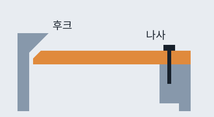
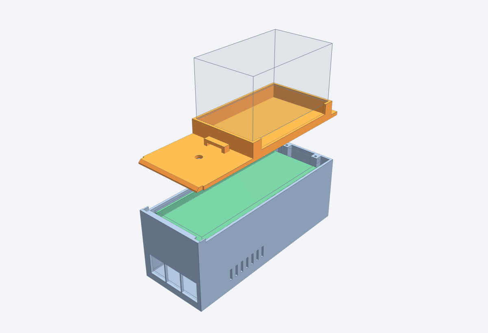
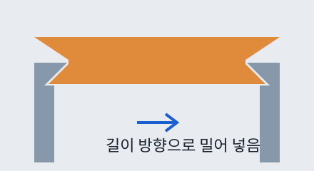
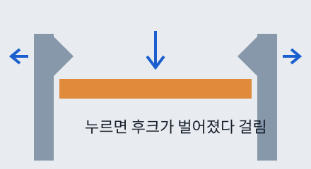
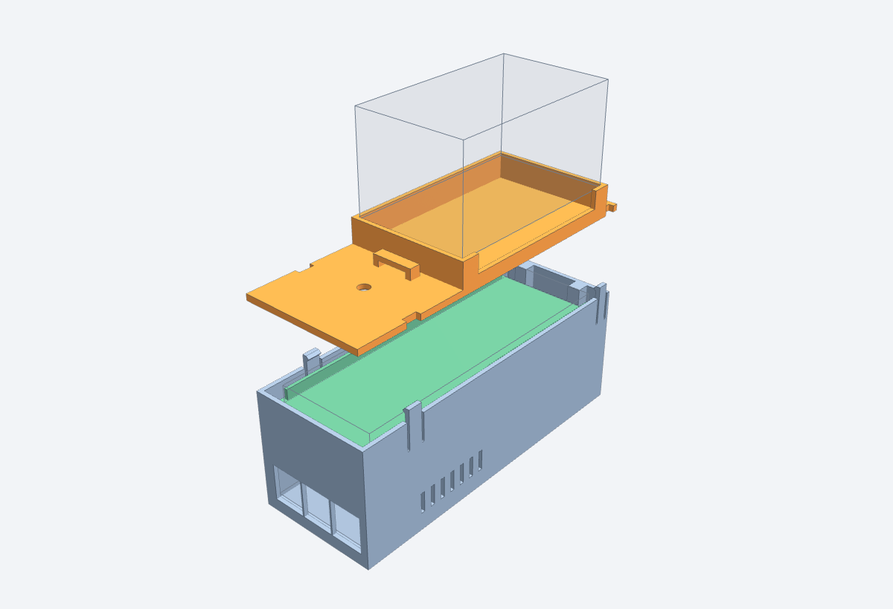

[← 요약으로](../README.md) · [이전: 리포트 2. 개선 목록](2-improve.md) · [다음: 모델과 STL](models.md)

# 리포트 3. 설계 방향

풀사이즈 빵판을 유지한다는 조건에서, 라파이 위에 선반을 얹는 **2층 구조는 그대로 두고** 높이를 늘리며 외부 받침과 나사를 줄입니다.

## 구조 변경

| 구조 변경 | 원본 도면 | 수정안 | 연결된 모델 |
|---|---|---|---|
| **빵판 위 공간** | 1.2 mm | 20.2 mm. 듀폰 점퍼가 들어가는 높이 | 케이스 [A](../models/A_case.stl) · [B](../models/B_case.stl) · [C](../models/C_case.stl) `jumper` |
| **라파이와 선반 사이** | 3 mm | 8 mm. GPIO 선이 꺾일 자리와 방열판 공간 | 케이스 [A](../models/A_case.stl) · [B](../models/B_case.stl) · [C](../models/C_case.stl) `piClear` |
| **삼각대 결합** | 외부 받침 + 아래로 열린 너트 포켓 | 받침 삭제, 케이스 안쪽 너트 보스 | 케이스 [A](../models/A_case.stl) · [B](../models/B_case.stl) · [C](../models/C_case.stl) `nutX` `nutFloor` |
| **웹캠 받침** | 이중 바닥, 뚜껑 오른쪽 끝 | 뚜껑 판이 바닥, 왼쪽으로 10 mm 이동 | 뚜껑 [A](../models/A_lid.stl) · [B](../models/B_lid.stl) · [C](../models/C_lid.stl) |
| **웹캠 케이블** | 뚜껑 구멍으로 내부 연결 | 바깥으로 돌려 USB 창에 연결 | 케이스 [A](../models/A_case.stl) · [B](../models/B_case.stl) · [C](../models/C_case.stl) |
| **결합 방식** | 나사 8개 | 추천 3가지 중 선택 | [A](../models/A_lid.stl) · [B](../models/B_lid.stl) · [C](../models/C_lid.stl) |

## 층별 높이

| 층 (아래부터) | 원본 | A · C | B | 바뀐 이유 |
|---|:---:|:---:|:---:|---|
| 외부 받침 | 8.0 | 0 | 0 | 너트를 케이스 안쪽 보스로 옮김 |
| 바닥 + 스탠드오프 | 7.4 | 7.4 | 7.4 |  |
| 라파이 | 19.0 | 19.0 | 19.0 |  |
| 라파이 위 여유 | 3.0 | 8.0 | 8.0 | GPIO 선이 꺾일 자리, 방열판 공간 |
| 선반 | 2.4 | 2.4 | 2.4 |  |
| 빵판 | 10.0 | 10.0 | 10.0 |  |
| 빵판 위 공간 | 1.2 | 20.2 | 20.2 | 듀폰 점퍼가 들어가는 높이 |
| 뚜껑 (+ 받침 바닥) | 5.8 | 3.4 | 4.9 | 이중 바닥 삭제. B는 레일 단면만큼 두꺼움 |
| 웹캠 | 55.3 | 55.3 | 55.3 |  |
| 합계 | 112.1 | 125.7 | 127.2 | 삼각대 플레이트 면 기준 |

외부 받침 8 mm를 없애도 점퍼선 공간이 늘어 전체는 13.6~15.1 mm 높아집니다. 높이가 부담이면 납작한 단선 점퍼를 쓰는 조건으로 `jumper` 값을 줄여 [다시 생성](parametric.md)하면 됩니다.

## 추천 결합 방식 3가지

원본은 나사 8개로 고정합니다. 이 케이스에는 아래 세 가지를 추천 순서대로 권하며, 셋 다 출력용 모델로 만들었습니다.

<table>
<tr>
<td width="33%" align="center" valign="top">
<h4>추천 1 · 후크 + 나사</h4>
 
 
<b>모델 A</b> · 첫 출력, 이동 사용
</td>
<td width="33%" align="center" valign="top">
<h4>추천 2 · 더브테일 슬라이드</h4>
 
 
<b>모델 B</b> · 자주 열어 배선을 바꿀 때
</td>
<td width="33%" align="center" valign="top">
<h4>추천 3 · 캔틸레버 스냅락</h4>
 
 
<b>모델 C</b> · 실내 고정 사용
</td>
</tr>
<tr>
<td valign="top">
<b>원리</b> 한쪽 끝은 45° 후크 밑에 끼우고 반대쪽만 나사로 잠급니다.  
<b>적용</b> 뚜껑 왼쪽 끝을 케이스 후크에, 오른쪽을 M3 2개로. 나사가 4개에서 2개로 줄어듭니다.  
<b>주의</b> 후크가 뚜껑 판 위로 올라오므로 그 자리는 비워 둬야 합니다.  
<code>A_case.stl · A_lid.stl</code>
</td>
<td valign="top">
<b>원리</b> 벽 위 45° 레일에 뚜껑의 경사진 모서리를 옆에서 밀어 넣습니다.  
<b>적용</b> 뚜껑 전체를 오른쪽에서 밀어 넣고 잠금 핀 2개로 빠짐을 막습니다. 웹캠 무게를 레일 전체가 받습니다.  
<b>주의</b> 레일이 길수록 공차와 휨에 민감합니다. 30 mm 시험 조각으로 여유 0.4 mm를 먼저 확인하세요.  
<code>B_case.stl · B_lid.stl · B_lock_pin.stl</code>
</td>
<td valign="top">
<b>원리</b> 벽 일부를 세로 홈으로 잘라 휘는 외팔보로 만들고, 끝의 걸림턱이 뚜껑을 누릅니다.  
<b>적용</b> 긴 벽에 후크 4개. 보 길이 22 mm, 걸림 1.1 mm라 휨 변형률이 약 0.8%로 낮습니다.  
<b>주의</b> 서포트 없이 뽑으려고 걸림턱을 45°로 했기 때문에 세게 당기면 풀립니다. 층 방향으로 휘므로 벽 3줄 이상이 필요합니다.  
<code>C_case.stl · C_lid.stl</code>
</td>
</tr>
</table>

| 모델 | 케이스 | 뚜껑 | 추가 부품 |
|:---:|---|---|---|
| **A** | [A_case.stl](../models/A_case.stl) | [A_lid.stl](../models/A_lid.stl) | M3 x 10 셀프탭 2, M2.5 x 6 2 |
| **B** | [B_case.stl](../models/B_case.stl) | [B_lid.stl](../models/B_lid.stl) | [B_lock_pin.stl](../models/B_lock_pin.stl) 2개 출력 |
| **C** | [C_case.stl](../models/C_case.stl) | [C_lid.stl](../models/C_lid.stl) | 없음 |

> [!TIP]
> 첫 출력이거나 들고 다니면 **1번**, 자주 열어 배선을 바꾸면 **2번**, 실내에 고정해 두고 쓰면 **3번**이 맞습니다.
