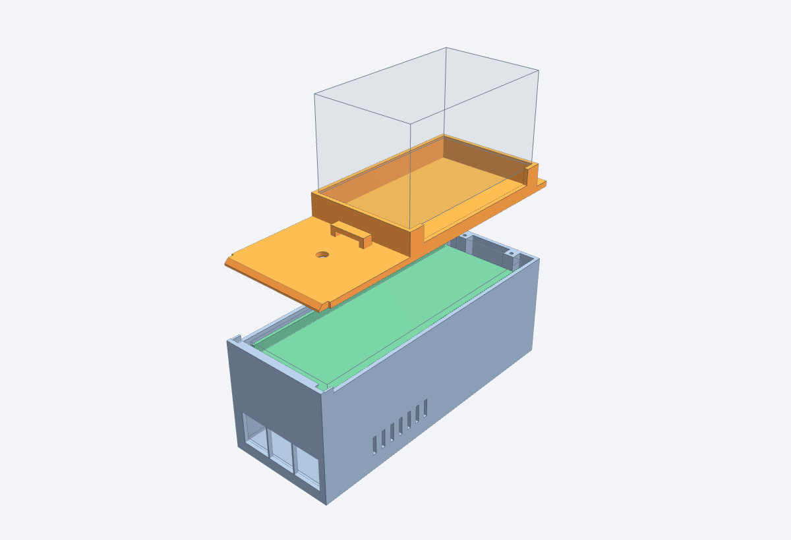
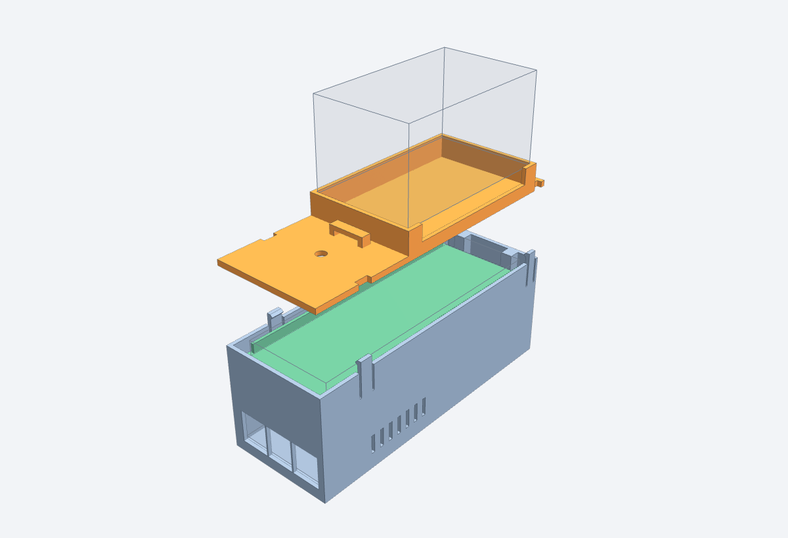

[← 요약으로](../README.md) · [이전: 리포트 3. 설계 방향](3-direction.md) · [다음: 파라메트릭 적용 기능](parametric.md)

# 모델과 STL

케이스 몸체, 선반, 웹캠 받침은 세 버전이 같고 뚜껑과 라파이를 고정하는 방식만 다릅니다. 리포트 1과 2의 항목은 세 버전에 똑같이 들어가 있고, 리포트 3의 결합 방식이 버전을 가릅니다.

| A · 나사형 | B · 슬라이드형 | C · 스냅락형 |
|:---:|:---:|:---:|
|  |  |  |

회색은 케이스, 초록은 선반, 주황은 뚜껑과 웹캠 받침입니다. 선으로만 그린 상자는 라파이, 빵판, 웹캠 자리입니다.

## 버전 비교

|  | A · 나사형 | B · 슬라이드형 | C · 스냅락형 |
|---|---|---|---|
| **뚜껑 고정** | 왼쪽 끝을 케이스 후크 밑에 끼우고 오른쪽을 M3 2개로 고정 | 45° 레일에 오른쪽에서 밀어 넣고 출력한 잠금 핀 2개를 눌러 끼워 고정 | 위에서 누르면 스냅 후크 4개가 걸림 |
| **라파이 고정** | 위치 핀 2개 + M2.5 나사 2개 | 위치 핀 2개 (나사 구멍도 있어 추가 가능) | 위치 핀 2개 (나사 구멍도 있어 추가 가능) |
| **구매 부품** | M3 x 10 셀프탭 2, M2.5 x 6 2, 1/4" 너트 1 | 1/4" 너트 1 | 1/4" 너트 1 |
| **전체 높이** | 125.7 | 127.2 | 125.7 |
| **LED** | 뚜껑 구멍(Ø6.4)으로 올라옴 | 뚜껑 아래에 두고 Ø5 창으로 빛만 보임. 다리를 잘라야 함 | 뚜껑 구멍(Ø6.4)으로 올라옴 |
| **장점** | 공차에 가장 둔감하고 확실함 | 웹캠 무게를 레일 전체로 받음. 공구 없이 분해 | 가장 빨리 여닫음. 공구와 추가 부품이 없음 |
| **주의점** | 드라이버 필요 | 186 mm 레일이라 프린터 공차와 휨에 민감. 시험 조각 필수 | 걸림턱이 45°라 세게 당기면 풀림. 삼각대를 많이 기울이는 용도에는 부적합 |
| **권장 상황** | 첫 출력, 야외나 이동 사용 | 공차를 맞출 수 있고 자주 열어 배선을 바꿀 때 | 실내 고정 사용, 결합 방식 시험용 |

## 부품과 STL 14개

| 파일 | 버전 | 부품 | 크기 (mm) | 부피 (cm³) | 출력 방향 |
|---|:---:|---|:---:|:---:|---|
| [A_case.stl](../models/A_case.stl) | A | 케이스 (나사형) | 185.8 x 75.4 x 70.9 | 114.5 | 바닥을 베드에 |
| [A_lid.stl](../models/A_lid.stl) | A | 뚜껑 (나사형) | 183.1 x 68.9 x 17.4 | 53 | 판을 베드에, 받침이 위 |
| [test_A_floor.stl](../models/test_A_floor.stl) | A | 시험 조각: 라파이 바닥 + 너트 보스 | 133.9 x 68.9 x 12 | 28.7 | 스탠드오프·핀·창·너트 맞춤 확인 |
| [B_case.stl](../models/B_case.stl) | B | 케이스 (슬라이드형) | 185.8 x 75.5 x 71.9 | 114.7 | 바닥을 베드에 |
| [B_lid.stl](../models/B_lid.stl) | B | 뚜껑 (슬라이드형) | 185.8 x 68.9 x 18.9 | 69.3 | 판을 베드에, 받침이 위 |
| [B_lock_pin.stl](../models/B_lock_pin.stl) | B | 잠금 핀 (2개 출력) | 7.5 x 7.5 x 14.9 | 0.2 | 머리를 베드에 |
| [test_B_rail_case.stl](../models/test_B_rail_case.stl) | B | 시험 조각: 레일 (케이스 쪽) | 30 x 68.9 x 9.5 | 4.4 | 슬라이드 공차 확인 |
| [test_B_rail_lid.stl](../models/test_B_rail_lid.stl) | B | 시험 조각: 레일 (뚜껑 쪽) | 30 x 68.9 x 4.9 | 9.5 | 슬라이드 공차 확인 |
| [C_case.stl](../models/C_case.stl) | C | 케이스 (스냅락형) | 185.8 x 75.4 x 73.2 | 113.8 | 바닥을 베드에 |
| [C_lid.stl](../models/C_lid.stl) | C | 뚜껑 (스냅락형) | 185.8 x 68.9 x 17.4 | 53.7 | 판을 베드에, 받침이 위 |
| [test_C_snap_case.stl](../models/test_C_snap_case.stl) | C | 시험 조각: 스냅 후크 (케이스 쪽) | 24 x 68.9 x 26.2 | 4.8 | 스냅 걸림 확인 |
| [test_C_snap_lid.stl](../models/test_C_snap_lid.stl) | C | 시험 조각: 스냅 후크 (뚜껑 쪽) | 24 x 68.9 x 3.4 | 5.3 | 스냅 걸림 확인 |
| [shelf.stl](../models/shelf.stl) | 공통 | 선반 (공통) | 166 x 63.3 x 8.4 | 27.2 | 판을 베드에, 레일이 위 |
| [test_window.stl](../models/test_window.stl) | 공통 | 시험 조각: USB/랜 창 + 떼어내는 리브 | 10.4 x 68.9 x 31 | 4.7 | 브리지 처짐과 리브 제거 확인 |

부피는 속을 꽉 채웠을 때 값입니다. `test_`로 시작하는 파일은 본체 전에 맞춤만 확인하는 시험 조각입니다.

> [!TIP]
> GitHub에서 STL 파일을 열면 3D로 돌려 볼 수 있습니다. 조립된 모습과 분해도는 [`docs/index.html`](../docs/index.html)을 내려받아 브라우저로 열면 볼 수 있습니다.
